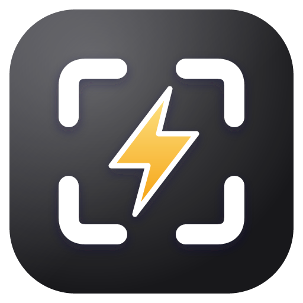

<p align="center">
  
</p>

<h1 align="center">FastShot</h1>

<p align="center">
  <strong>Capture. Mark up. Share.</strong><br>
  A fast, private screenshot tool built natively for macOS.
</p>

<p align="center">
  
  
  
</p>

FastShot stays in your menu bar and is ready whenever you need it. Capture a region, window, display, or scrolling page; add clear annotations; permanently remove sensitive details; then copy or save the result without breaking your flow.

## Why FastShot

| | |
|---|---|
| **⚡ Capture instantly** | Use `⌘ ⇧ 9`, the menu bar, or a custom shortcut to capture any region, window, or display. |
| **✏️ Explain visually** | Add arrows, shapes, highlights, text, numbered steps, freehand marks, blur, and pixelation. |
| **🔒 Redact for real** | Solid redaction permanently replaces pixels before an image is copied, saved, or passed to OCR. |
| **⌘ Stay in control** | Choose an editor or floating preview, then copy, quick-save, or automate both actions. |

## More than a screenshot

- **Pin to screen** — float any capture above other apps for reference. Drag to move, scroll or pinch to zoom, Option-scroll to fade, double-click or `Esc` to close.
- **Scrolling capture** — build a long screenshot by adding overlapping frames as you scroll.
- **Text and QR recognition** — copy text or QR payloads with on-device Apple Vision. Links are never opened automatically.
- **Repeat area** — recapture the same part of a display during the current app session.
- **Flexible output** — save as PNG or JPEG with collision-safe filenames and a custom destination.
- **Multi-display aware** — select and edit captures on the display where they were taken.
- **Private by design** — no account, analytics, or telemetry. Update checks contact GitHub; captures stay local.

## A focused workflow

1. Press `⌘ ⇧ 9` and choose **Region**, **Window**, or **Display**.
2. Select what matters and add annotations when you need them. **Capture Display** instantly captures the whole display under your pointer and opens a resizable editor with a top annotation toolbar, a fitted canvas, and zoom controls.
3. Press `⌘ C` to copy, `⌘ S` to choose a destination, or `⌘ ⇧ S` to quick-save.

FastShot can also show a lightweight floating preview after an area capture. From there, edit, copy, save, or dismiss the screenshot without opening the full editor.

## Keyboard-first editing

| Action | Shortcut | Action | Shortcut |
|---|---:|---|---:|
| Select and move | `V` | Pen | `P` |
| Line | `L` | Arrow | `A` |
| Rectangle | `R` | Ellipse | `E` |
| Highlighter | `H` | Text | `T` |
| Numbered step | `N` | Redact | `X` |
| Blur | `B` | Pixelate | `M` |

Use `⌘ P` to pin the capture to the screen, `⌘ Z` / `⌘ ⇧ Z` to undo or redo, and `Esc` to cancel a capture. Global shortcuts for fullscreen, area, repeat area, windows, scrolling capture, app visibility, and recognition can all be configured or cleared independently.

## On-device recognition

Press `⌘ ⇧ C` in the editor for fast text recognition. Hold Option and press `⌥ ⌘ ⇧ C` for the slower, more accurate Vision model with broader language support.

Recognition always runs locally. FastShot renders annotations and permanent redactions first, so OCR receives the same sanitized image that you copy or save.

## Download and updates

Download the universal ZIP from [GitHub Releases](https://github.com/sayeedjoy/fastshot/releases/latest), extract it, and move **FastShot.app** to **Applications**. Requires macOS 14 or later; supports Apple Silicon and Intel Macs. Ad hoc signed releases may require **System Settings → Privacy & Security → Open Anyway** on first launch.

Release builds include signed in-app updates. Use **Check for Updates…** in the menu bar or **Settings → About** to download, install, and relaunch a newer version. Screenshots and OCR stay local; update checks contact GitHub.

Maintainers: see [publishing releases and configuring update signing](docs/RELEASING.md).

## Install from source

FastShot requires **macOS 14 or later** and **Xcode with Swift 6.2 or later**.

```sh
./scripts/install.sh
```

From the repository root, the install script builds a Release app, places it at `~/Applications/FastShot.app`, and launches it. On first run, allow FastShot under **System Settings → Privacy & Security → Screen & System Audio Recording**.

To build without installing, open `FastShot.xcodeproj` and run the **FastShot** scheme, or use:

```sh
xcodebuild -project FastShot.xcodeproj -scheme FastShot -configuration Release \
  -derivedDataPath .build-xcode CODE_SIGN_IDENTITY=- CODE_SIGN_STYLE=Manual build

open .build-xcode/Build/Products/Release/FastShot.app
```

> The local build is ad hoc signed. Developer ID signing and notarization are separate release steps.

## Privacy and redaction

FastShot uses ScreenCaptureKit for capture and Apple Vision for recognition. Processing stays on your Mac.

Permanent **Redact** fills are applied last to a fresh output raster and are included in copied images, exported files, and OCR input. Blur and pixelation are visual effects, not secure redaction. For the strongest pixel-boundary guarantees, use Redact and export as PNG; JPEG compression can alter edges.

FastShot does not carry the original image metadata or editable layers into exports. Clipboard managers and other software may still retain anything you copy.

## Open source and contributions

FastShot is open source under the [GNU Affero General Public License v3.0 or later](LICENSE). Contributions are welcome—see [CONTRIBUTING.md](CONTRIBUTING.md) for the development workflow and pull-request guidelines.

The AGPL allows people to study, modify, and redistribute FastShot, while requiring distributed modified versions to remain open and provide their corresponding source.

## Development

The app is built with SwiftUI, AppKit, ScreenCaptureKit, Core Graphics, Core Image, and Vision. It includes both an Xcode app target and a Swift Package used for tests.

```sh
swift build
swift test

# Optional native view snapshots using synthetic content
FASTSHOT_SNAPSHOT_DIR=/tmp/fastshot-native-qa swift test
```

Tests use synthetic images and do not require screen-recording permission. They cover capture geometry, editing history, shortcuts and preferences, safe output naming, OCR/QR recognition, image encoding, and redaction ordering.

---

<p align="center">
  Built for the Mac. Designed to stay out of your way.
</p>
